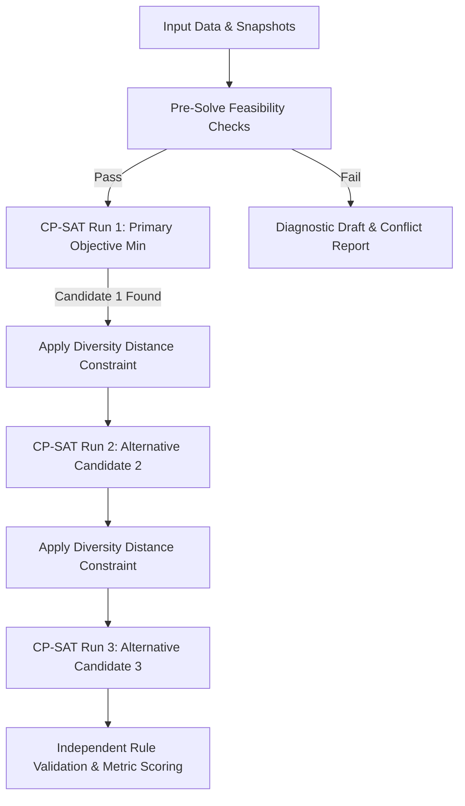

# EduPlus — Optimization Engine & Scheduler Design

> **Document ID:** SCHEDULER_DESIGN  
> **Version:** 0.1  
> **Status:** Mathematical Specification — Planned for Phase 3 Implementation  
> **Engine:** Google OR-Tools CP-SAT (Constraint Programming with SAT Solvers)  

---

## 1. Solver Selection & Rationale

Timetable generation is an NP-hard combinatorially constrained discrete optimization problem. EduPlus proposes **Google OR-Tools CP-SAT** as the core solving technology.

### Technology Comparison

| Engine Paradigm | Solvers Evaluated | Strengths | Weaknesses in Academic Scheduling | Verdict |
| :--- | :--- | :--- | :--- | :--- |
| **Constraint Programming (SAT-based)** | **Google OR-Tools CP-SAT** | Highly efficient on interval scheduling, native `AddNoOverlap` and `Cumulative` propagators, deterministic proofs of infeasibility, robust timeout handling, native multi-threading. | Modeling requires expressing all constraints in integer/boolean domain. | **Chosen Architecture** |
| **Mixed-Integer Linear Programming (MILP)** | Gurobi, CBC, SCIP | Strong on linear cost objectives. | Inefficient on disjunctive non-overlap scheduling; requires enormous numbers of big-M binary indicator variables. | Rejected |
| **Metaheuristics / Genetic Algorithms** | OptaPlanner / Timefold, DEAP | Fast initial feasible solution on simple models. | Cannot prove infeasibility; struggles to escape deep local minima caused by strict multi-group elective overlap constraints. | Secondary / Not Primary |
| **Backtracking Heuristics** | Custom Python solvers | Zero external dependencies. | Unusable combinatorial explosion on realistic department constraints; high risk of infinite or non-terminating search. | Rejected |

---

## 2. Mathematical Formulation

### 2.1 Index Sets and Parameters

- $D = \{1, \dots, 6\}$: Set of active working days (Monday = 1, ..., Saturday = 6).
- $T = \{1, \dots, 8\}$: Ordered time slots per day (`TS1` to `TS8`).
- $R$: Set of available rooms (classrooms $R_{\text{class}}$ and laboratories $R_{\text{lab}}$).
- $F$: Set of faculty / teachers.
- $G$: Set of student groups (divisions $G_{\text{div}}$, batches $G_{\text{batch}}$, and elective groups $G_{\text{elec}}$).
- $S$: Set of required curriculum session instances.
- For each session $s \in S$:
  - $d_s \in \{1, 2\}$: Duration in hours (1 for lectures/tutorials, 2 for practicals).
  - $F_s \subseteq F$: Qualified teacher(s) assigned to session $s$.
  - $G_s \subseteq G$: Target student group(s).
  - $R_s \subseteq R$: Feasible physical rooms (e.g., must have required capabilities and adequate capacity).
  - $type_s \in \{\text{lecture}, \text{tutorial}, \text{practical}\}$.

---

### 2.2 Decision Variables

EduPlus models scheduling using both boolean assignment indicators and CP-SAT interval variables:

1. **Interval Variables:**
   For each session $s \in S$, we define an interval variable:
   $$\text{Interval}_s = \text{model.NewIntervalVar}(\text{start}_s, d_s, \text{end}_s, \text{name}=f\text{"session\_}\{s\}\text{"})$$
   where:
   - $\text{start}_s \in [0, |D| \times |T| - 1]$
   - $\text{end}_s = \text{start}_s + d_s$
   - $\text{day}_s = \text{start}_s \mathbin{/} |T|$
   - $\text{slot}_s = \text{start}_s \pmod{|T|}$

2. **Assignment Variables (Boolean):**
   - $x_{s, d, t} \in \{0, 1\}$: 1 if session $s$ begins on day $d$ at slot $t$; 0 otherwise.
   - $y_{s, r} \in \{0, 1\}$: 1 if session $s$ is held in room $r \in R_s$; 0 otherwise.
   - $z_{s, f} \in \{0, 1\}$: 1 if session $s$ is conducted by teacher $f \in F_s$; 0 otherwise.

---

### 2.3 Level A: Hard Structural Constraints

A solution is strictly invalid if any Level A constraint is violated. The solver must enforce these as hard boolean constraints:

#### A01: Teacher Conflict Free
No teacher can be assigned to multiple sessions simultaneously:
$$\sum_{s \in S \mid f \in F_s} \sum_{t' = t - d_s + 1}^{t} x_{s, d, t'} \cdot z_{s, f} \le 1, \quad \forall f \in F, \forall d \in D, \forall t \in T$$
*CP-SAT Implementation:* `model.AddNoOverlap([Interval_s for s in S_f])`

#### A02: Room Conflict Free
No physical room can host more than one session concurrently:
$$\sum_{s \in S \mid r \in R_s} \sum_{t' = t - d_s + 1}^{t} x_{s, d, t'} \cdot y_{s, r} \le 1, \quad \forall r \in R, \forall d \in D, \forall t \in T$$
*CP-SAT Implementation:* `model.AddNoOverlap([Interval_s for s in S_r])`

#### A03: Student Group Conflict Free
Groups that share students cannot have simultaneous sessions. If groups $g_a, g_b$ overlap ($\text{Overlap}(g_a, g_b) > 0$):
$$\sum_{s \in S \mid g_a \in G_s} \sum_{t' = t - d_s + 1}^{t} x_{s, d, t'} + \sum_{s' \in S \mid g_b \in G_{s'}} \sum_{t' = t - d_{s'} + 1}^{t} x_{s', d, t'} \le 1, \quad \forall d \in D, \forall t \in T$$

#### A04: Batch Partition Concurrency
When practical sessions occur for a division, all batches ($B_1, B_2, B_3$) must be scheduled simultaneously during the same 2-hour window in distinct laboratories:
$$\text{start}_{s_1} = \text{start}_{s_2} = \text{start}_{s_3}, \quad \forall (s_1, s_2, s_3) \in \text{LabBlock}(div)$$

#### A05: Consecutive Lab Block Preservation
For any practical session ($d_s = 2$), the session must span consecutive slots without crossing the daily boundary or lunch break:
$$\text{slot}_s \in \{1, 3, 5, 7\} \setminus \{\text{lunch\_slot} - 1, |T|\}$$

#### A06: Daily Working Window & Day Bounds
No session may start such that it extends beyond the final slot of the day:
$$\text{slot}_s + d_s \le |T| + 1, \quad \forall s \in S$$

#### A07: Mandatory Division Lunch Window
For each division $g \in G_{\text{div}}$, exactly one designated slot $L_g \in \{\text{TS5}, \text{TS6}\}$ is strictly preserved as free:
$$\sum_{s \in S \mid g \in G_s} \sum_{t' = L_g - d_s + 1}^{L_g} x_{s, d, t'} = 0, \quad \forall d \in D$$

#### A08: Hard Faculty Unavailability
If teacher $f$ is marked unavailable on day $d$ during slot $t$:
$$\sum_{s \in S \mid f \in F_s} \sum_{t' = t - d_s + 1}^{t} x_{s, d, t'} \cdot z_{s, f} = 0$$

---

### 2.4 Level B: Policy Constraints

Policy constraints represent institutional rules. In standard generation, these are enforced as hard limits. During diagnostic or relaxed generation, they may be selectively penalized or relaxed with administrative authorization.

#### B01: Student Daily Load Limit
Total student class hours per day $\le 6$:
$$\sum_{s \in S \mid g \in G_s} d_s \cdot x_{s, d} \le 6, \quad \forall g \in G_{\text{div}}, \forall d \in D$$

#### B02: Faculty Daily Teaching Limit
Maximum faculty teaching hours per day $\le 5$:
$$\sum_{s \in S \mid f \in F_s} d_s \cdot x_{s, d} \cdot z_{s, f} \le 5, \quad \forall f \in F, \forall d \in D$$

#### B03: Faculty Max Consecutive Hours
Faculty cannot teach more than 3 consecutive hours without at least a 1-hour break:
$$\sum_{t' = t}^{t + 3} \text{is\_teaching}(f, d, t') \le 3, \quad \forall f \in F, \forall d \in D, \forall t \in \{1, \dots, |T| - 3\}$$

#### B04: Faculty Weekly Workload Cap
Total teaching hours per week $\le \text{cap}_f$:
$$\sum_{d \in D} \sum_{s \in S \mid f \in F_s} d_s \cdot x_{s, d} \cdot z_{s, f} \le \text{cap}_f, \quad \forall f \in F$$

#### B05: Maximum Student Internal Gap
No student schedule may contain an internal dead gap $\ge 2$ hours (excluding lunch). Gaps of 1 hour are allowed but penalized.

---

### 2.5 Level C: Soft Optimization Objectives

The objective function minimizes total penalty across soft academic preferences:
$$\min Z = \sum_{k} w_k \cdot P_k$$

Where $w_k$ are configurable institutional weights:

1. **Internal Student Gap Penalty ($P_1$, weight $w_1 = 15$):**
   Penalize any 1-hour idle window between classes for a student division.
2. **Room Switch / Floor Hop Penalty ($P_2$, weight $w_2 = 10$):**
   Penalize back-to-back division sessions occurring on different floors.
3. **Faculty Preferred Slot Match ($P_3$, weight $w_3 = 8$):**
   Reward scheduling faculty during their declared preferred time slots.
4. **Subject Weekly Spread ($P_4$, weight $w_4 = 12$):**
   Prevent scheduling lectures of the same subject on the same day when weekly count $\le 4$.
5. **Even Daily Load Balance ($P_5$, weight $w_5 = 5$):**
   Minimize variance of total teaching hours across Monday through Saturday.

---

## 3. Candidate Generation & Diversity

Rather than producing a single brittle solution, the solver pipeline generates up to 3 diverse candidates for administrative review:



### Diversity Metric
Candidate diversity is enforced by adding a minimum Hamming distance constraint on slot allocations:
$$\sum_{s \in S} | \text{start}_s^{(k)} - \text{start}_s^{(1)} | \ge \theta_{\text{min}}$$

---

## 4. Solver Input and Output Contracts

### 4.1 Input Schema (`SolveRequest`)
```json
{
  "department_id": "d0000001-0000-0000-0000-000000000001",
  "academic_year_code": "2026-27",
  "semester": 1,
  "time_limit_seconds": 90,
  "max_candidates": 3,
  "random_seed": 42,
  "relaxations": [],
  "sessions": [
    {
      "assignment_id": "ta001",
      "subject_id": "SUB301",
      "teacher_ids": ["t001"],
      "target_group_id": "div_3a",
      "target_group_type": "division",
      "duration_hours": 1,
      "session_type": "lecture",
      "feasible_room_ids": ["r101", "r102"]
    }
  ]
}
```

### 4.2 Output Schema (`SolveResponse`)
```json
{
  "status": "FEASIBLE",
  "solve_time_ms": 4820,
  "deterministic_seed": 42,
  "candidates": [
    {
      "candidate_id": "cand_01",
      "objective_score": 142.5,
      "hard_violations_count": 0,
      "policy_violations_count": 0,
      "scheduled_sessions": [
        {
          "assignment_id": "ta001",
          "teacher_id": "t001",
          "room_id": "r101",
          "day_index": 1,
          "slot_index": 2,
          "duration": 1
        }
      ]
    }
  ]
}
```

---

## 5. Performance, Timeouts & Known Limitations

1. **Execution Timeouts:** The solver process is executed with an OS-level wall-clock ceiling (default: 120 seconds). If CP-SAT hits the timeout, it returns the best feasible candidate found along with the optimality gap.
2. **Memory Footprint:** Peak memory during search across 4 years (8 divisions, 32 lab batches) is budgeted at $\le 1.5\text{ GB RAM}$.
3. **Reproducibility:** Solver runs are fully deterministic by setting `parameters.random_seed` and pinning thread worker count (`num_search_workers = 8`).
4. **Implementation Status:** The CP-SAT engine is planned for Phase 3. The current prototype demo uses deterministic, pre-computed mock candidates (`MOCK_TIMETABLE_VALID` and `MOCK_TIMETABLE_CONFLICT`) to demonstrate the user interface.
