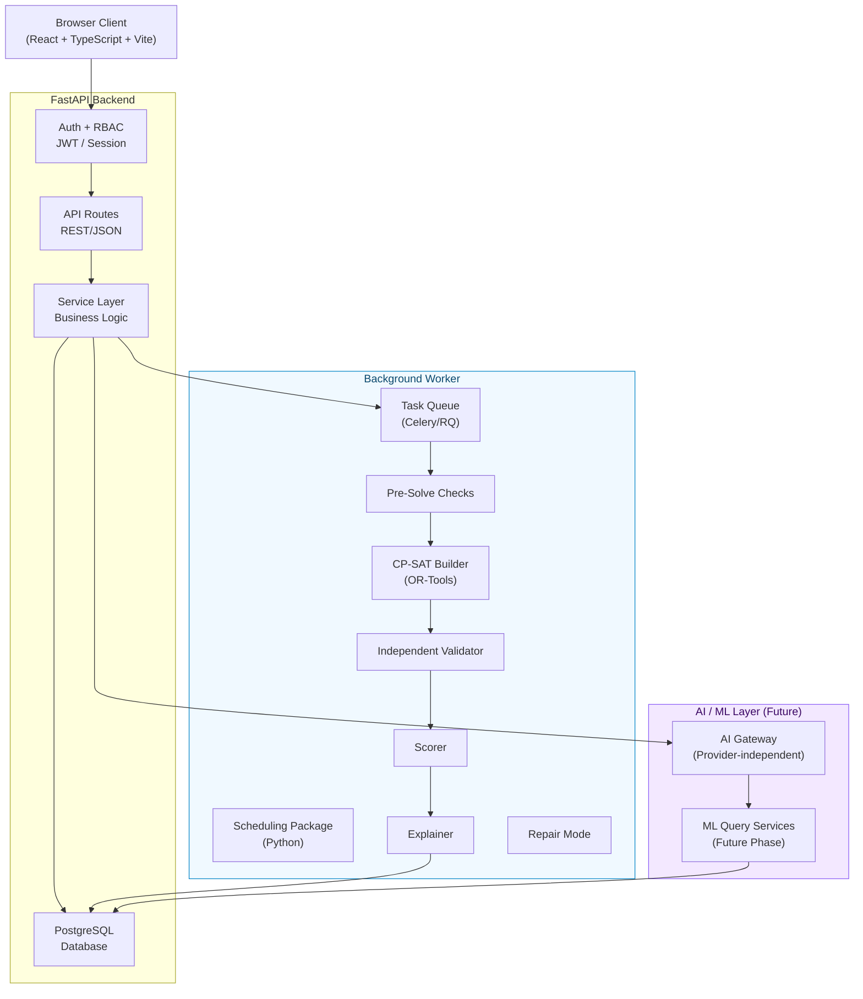

# EduPlus — System Architecture

> **Document ID:** SYSTEM_ARCHITECTURE  
> **Version:** 0.1  
> **Status:** Design specification — production architecture not yet implemented

---

## 1. Architecture Overview

EduPlus uses a **modular monolith** approach for Version 1, with the scheduling package kept strictly separate from the web application. This avoids unnecessary microservice complexity while maintaining the clean boundaries required for independent testing and future decomposition.

```
┌─────────────────────────────────────────────────────────────────────────┐
│                          TRUST BOUNDARY                                  │
│                                                                          │
│  ┌──────────────┐      HTTPS       ┌─────────────────────────────────┐  │
│  │   Browser    │ ◄──────────────► │         FastAPI Backend          │  │
│  │  (React/JS)  │                  │                                  │  │
│  │              │                  │  ┌───────────┐  ┌─────────────┐ │  │
│  │  Login page  │                  │  │   Auth    │  │   Routes    │ │  │
│  │  Admin dash  │                  │  │  + RBAC   │  │   + API     │ │  │
│  │  Teacher dash│                  │  └───────────┘  └──────┬──────┘ │  │
│  │  Student dash│                  │                        │         │  │
│  └──────────────┘                  │                        ▼         │  │
│                                    │  ┌──────────────────────────────┐│  │
│                                    │  │       Service Layer           ││  │
│                                    │  │  - AcademicDataService       ││  │
│                                    │  │  - TimetableService          ││  │
│                                    │  │  - GenerationService         ││  │
│                                    │  │  - RepairService             ││  │
│                                    │  │  - RequestService            ││  │
│                                    │  └──────────┬───────────────────┘│  │
│                                    │             │                     │  │
│                                    └─────────────┼─────────────────────┘  │
│                                                  │                         │
│                ┌─────────────────────────────────┼──────────────────────┐  │
│                │                                 ▼                      │  │
│                │  ┌────────────────┐   ┌─────────────────┐             │  │
│                │  │   PostgreSQL   │   │  Background      │             │  │
│                │  │   Database     │   │  Worker          │             │  │
│                │  │                │   │  (Celery/RQ)     │             │  │
│                │  └────────────────┘   └────────┬────────┘             │  │
│                │                                │                      │  │
│                │                       ┌────────▼────────┐             │  │
│                │                       │  Scheduling      │             │  │
│                │                       │  Package         │             │  │
│                │                       │  ─────────────── │             │  │
│                │                       │  PreSolveCheck   │             │  │
│                │                       │  CPSATBuilder    │             │  │
│                │                       │  Solver          │             │  │
│                │                       │  Validator       │             │  │
│                │                       │  Scorer          │             │  │
│                │                       │  Explainer       │             │  │
│                │                       │  RepairMode      │             │  │
│                │                       └─────────────────┘             │  │
│                └──────────────────────────────────────────────────────┘  │
│                                                                          │
│  ┌──────────────────────────────────────────────────────────────────┐   │
│  │  AI Gateway (Future)    │    ML Query Services (Future Phase)    │   │
│  │  - Intent parsing       │    - SlotQueryModel                   │   │
│  │  - Structured routing   │    - ConflictExplainModel             │   │
│  │  - Provider abstraction │    - NLQueryRouter                    │   │
│  └──────────────────────────────────────────────────────────────────┘   │
└─────────────────────────────────────────────────────────────────────────┘
```

---

## 2. Component Diagram (Mermaid)



---

## 3. Component Responsibilities

### 3.1 Browser Client
- **Technology:** React + TypeScript + Vite + Tailwind CSS (production); current prototype uses plain HTML/CSS/JS
- **Responsibility:** Role-aware UI for admin, teacher, student
- **Authorization:** Frontend route guards are supplementary only — all authorization is enforced server-side
- **Mock state:** Prototype uses in-memory mock data; production client calls the REST API

### 3.2 FastAPI Backend
- **Technology:** Python 3.11+, FastAPI, Pydantic, SQLAlchemy
- **Responsibility:**
  - Authentication (JWT or session-based)
  - Role-based access control for every route
  - CRUD operations for academic data
  - Timetable version management
  - Job dispatch to background worker
  - Job status polling
  - Audit log writes

### 3.3 PostgreSQL Database
- **Technology:** PostgreSQL 15+
- **Responsibility:** Persistent storage for all domain entities, timetable versions, violations, audit logs, change requests
- **Immutability:** Published timetable versions are never overwritten; audit log rows are append-only

### 3.4 Background Worker
- **Technology:** Celery (or equivalent) with Redis or PostgreSQL as broker
- **Responsibility:** Execute potentially long-running scheduling and repair jobs asynchronously
- **Status reporting:** Job status is stored in the database; the API polls or uses webhooks
- **Independence:** The worker has no direct HTTP dependency on the API

### 3.5 Scheduling Package
- **Technology:** Pure Python package with Google OR-Tools CP-SAT
- **Responsibility:**
  - Accept a validated `InputSnapshot`
  - Run pre-solve feasibility checks
  - Build and solve the CP-SAT model
  - Independently validate every candidate
  - Score candidates against soft preferences
  - Generate structured constraint explanations
  - Support repair mode (frozen sessions, minimal change objective)
- **Independence guarantee:** This package contains no database access, no HTTP calls, no LLM calls. It is a pure function from input to output.

### 3.6 AI Gateway (Future)
- **Technology:** Provider-independent Python interface
- **Responsibility:**
  - Parse natural-language query intent
  - Validate and structure the output before routing
  - Route to the appropriate backend service (database query, constraint engine, ML model)
- **Hard limit:** The AI gateway cannot place sessions, validate timetables, or override scheduling constraints. These are exclusively performed by the CP-SAT solver and independent validator.

### 3.7 ML Query Services (Future Phase)
- **Technology:** Dedicated problem-solving ML models or model-based services
- **Responsibility:** Answer complex scheduling questions not addressable by deterministic database queries
- **Privacy:** Student names and individual records must not be sent to external ML APIs. Group-level or anonymized data only.

---

## 4. Data Flow — Timetable Generation

```
Admin request → API route → Auth/RBAC check → GenerationService
  → Build InputSnapshot from DB → validate snapshot
  → Dispatch job to Worker queue
  → Return job_id to client

Worker job:
  InputSnapshot → PreSolveCheck → (if infeasible: return diagnostics)
  → CPSATBuilder → Solver → (per candidate:)
     → IndependentValidator → Scorer → Explainer
  → Store candidates + violations + scores in DB
  → Mark job complete

Client polls job status → Gets candidate list → Admin selects + reviews
  → Admin clicks Publish → API publish endpoint → Validator re-check
  → If valid: create new TIMETABLE_VERSION (status=published)
  → Write AUDIT_LOG → Notify teachers and students
```

---

## 5. Trust Boundaries

| Boundary | What crosses it | What is enforced |
|----------|----------------|------------------|
| Browser → Backend | All data | JWT/session auth, RBAC, input validation, rate limiting |
| Backend → DB | All writes | SQLAlchemy ORM, parameterized queries (no raw SQL from user input) |
| Backend → Worker | Job dispatch | Serialized, validated input snapshot only |
| Worker → DB | Read snapshot, write results | Worker has limited write permissions (no user table, no audit log bypass) |
| Backend → AI Gateway | Structured query intent | No raw user input passed; no PII; validated schema |
| AI Gateway → ML Services | Structured anonymized data | Schema validation before sending; authorization check |

---

## 6. Deployment Approach (Planned)

The initial production deployment uses a single server with all components on the same machine, using process separation:

```
[nginx] → [FastAPI via gunicorn/uvicorn] → [PostgreSQL]
                ↓
          [Celery worker] → [Redis broker]
```

Future scaling: separate the scheduling worker to a dedicated compute node; containerize with Docker Compose or Kubernetes.

---

## 7. Architectural Decisions and Alternatives Considered

| Decision | Choice | Rationale |
|----------|--------|-----------|
| Backend framework | FastAPI | Async support, Pydantic validation, OpenAPI docs, Python native for scheduler integration |
| Database | PostgreSQL | Full relational integrity, JSON columns for snapshots, strong ecosystem |
| Scheduler separation | Independent Python package | Testable in isolation; no DB dependency; can be called directly or via worker |
| Background jobs | Celery/RQ | Solver may run 30–60+ seconds; must not block API threads |
| No microservices (V1) | Modular monolith | Avoids distributed system complexity before core domain is stable |
| LLM role | Supplementary only | LLM cannot be the correctness authority for constraint-based scheduling; must be validated and gated |
| Monorepo | Single repo | Easier to maintain consistency between frontend, backend, and scheduler during early development |

---

## 8. Known Architectural Risks

| Risk | Mitigation |
|------|-----------|
| Solver timeout leaves no result | Return diagnostic partial draft with explicit INCOMPLETE status; distinguish timeout from proven infeasibility |
| AI gateway routes incorrect action | All AI outputs are validated against schema and authorized before execution |
| Timetable version overwrite | Enforced at DB level with immutability constraint on published versions |
| Concurrent generation runs | Worker job queue ensures sequential or explicitly parallelized runs; DB locking on version creation |
| Student data in LLM calls | Privacy gate on AI gateway: group-level data only; no individual names or IDs sent externally |
