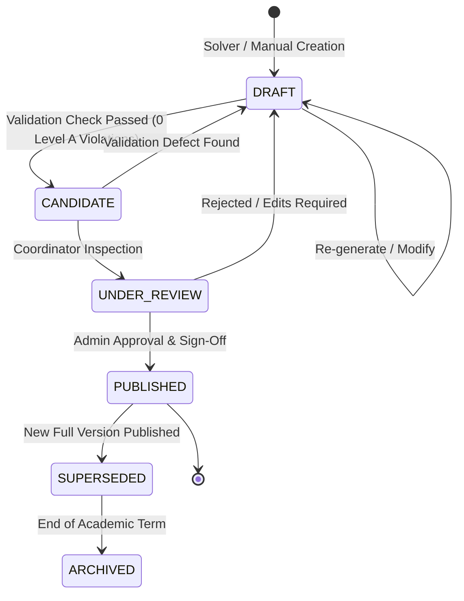
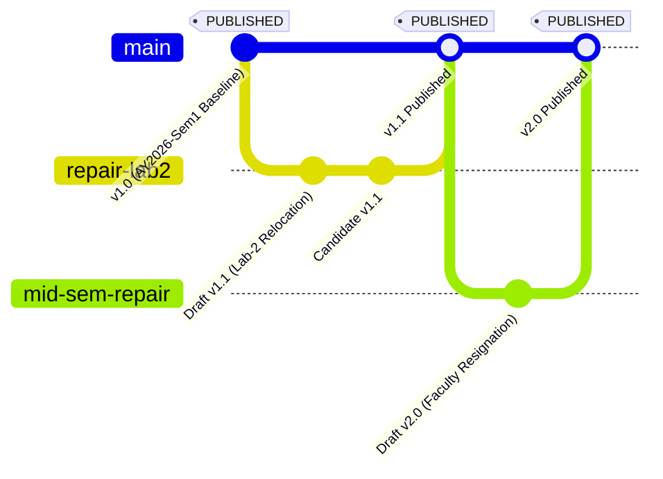
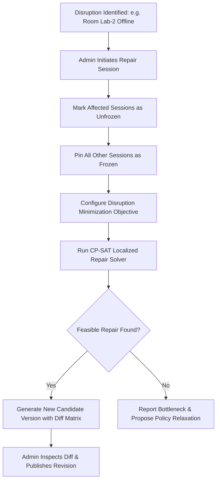

# EduPlus — Timetable Versioning, Repair & Exception Management

> **Document ID:** TIMETABLE_VERSIONING_AND_REPAIR  
> **Version:** 0.1  
> **Status:** Architecture Baseline — Planned for Phase 5  

---

## 1. Version Lifecycle & State Machine

In academic institutions, a published timetable is a binding operational contract between faculty, students, laboratory staff, and facilities management. In-place modification of published timetables destroys auditability and causes widespread confusion.

EduPlus implements an **Append-Only, Immutable Versioning Model**.



### State Definitions & Mutability Rules

| State | Mutability | Visibility | Allowed Actions |
| :--- | :--- | :--- | :--- |
| `DRAFT` | **Mutable** | Admin only | Cell edits, solver regeneration, parameter adjustments. |
| `CANDIDATE` | **Read-Only Draft** | Admin only | Independent rule validation, quality scoring, conflict report. |
| `UNDER_REVIEW` | **Read-Only** | Admin & HOD | Inspection, comparative diff analysis against baseline. |
| `PUBLISHED` | **Strictly Immutable** | All (Admin, Teachers, Students) | View, export (PDF/iCal), query, submit change requests, attach date-specific exceptions. |
| `SUPERSEDED` | **Strictly Immutable** | Admin (Audit/History) | Historical lookup, audit log inspection. |
| `ARCHIVED` | **Strictly Immutable** | Admin (Cold Storage) | Compliance and accreditation reporting. |

---

## 2. Version Lineage & Parent-Child Hierarchy

Every timetable revision tracks its lineage through `parent_version_id`. This creates an unbroken directed acyclic graph (DAG) of revisions throughout the semester.



### Database Representation
```sql
-- Query version lineage history
WITH RECURSIVE version_tree AS (
    SELECT id, version_number, parent_version_id, status, label, published_at
    FROM timetable_versions
    WHERE id = 'tt_current_published_uuid'
    UNION ALL
    SELECT t.id, t.version_number, t.parent_version_id, t.status, t.label, t.published_at
    FROM timetable_versions t
    JOIN version_tree vt ON t.id = vt.parent_version_id
)
SELECT * FROM version_tree ORDER BY version_number ASC;
```

---

## 3. Timetable Repair Workflow

Unforeseen academic disruptions occur regularly:
- A faculty member resigns or takes extended medical leave.
- A computer lab undergoes emergency hardware repairs for 3 weeks.
- Elective course enrollments change significantly after the add/drop window.

Rather than re-solving the entire department from scratch—which reshuffles hundreds of unaffected classes—EduPlus performs **Localized Constrained Repair**.



### 3.1 Frozen Sessions Mechanics
Each scheduled session in the repair pool has a boolean flag:
- `is_frozen = TRUE`: The solver treats this slot assignment as a hard, unalterable constant.
- `is_frozen = FALSE`: The solver is free to relocate this session to an alternative day, time, room, or substitute teacher.

### 3.2 Change Minimization Objective
The repair solver optimizes for **Minimal Perturbation**:
$$\min \Delta = \sum_{s \in S_{\text{unfrozen}}} \left( w_{\text{move}} \cdot \mathbb{I}(\text{slot}_s \ne \text{orig\_slot}_s) + w_{\text{day}} \cdot \mathbb{I}(\text{day}_s \ne \text{orig\_day}_s) + w_{\text{room}} \cdot \mathbb{I}(\text{room}_s \ne \text{orig\_room}_s) \right)$$

This mathematical formulation guarantees that the minimum possible number of teachers and student groups experience schedule changes.

---

## 4. Date-Specific Exceptions vs. Master Version Revisions

EduPlus enforces a clean architectural distinction between a **Permanent Weekly Template Change** and a **Temporary One-Off Date Exception**:

```
Disruption Scope
   │
   ├── Is it for a single day, holiday, or temporary substitution?
   │     └── YES ➔ Create `SESSION_EXCEPTION` (No new timetable version)
   │
   └── Does it alter the recurring weekly schedule permanently?
         └── YES ➔ Run Timetable Repair ➔ Publish New `TIMETABLE_VERSION`
```

### 4.1 Session Exceptions Table Semantics
For temporary disruptions (e.g., Prof. Sharma attending a conference on November 4th):
1. The master weekly schedule `TIMETABLE_VERSION` remains untouched.
2. An exception record is inserted in `session_exceptions`:
   - `scheduled_session_id`: UUID of Dr. Sharma's Tuesday 11:00 AM lecture.
   - `exception_date`: `2026-11-04`.
   - `exception_type`: `'substituted'`.
   - `substitute_teacher_id`: UUID of Dr. Rajesh Patel.
   - `reason`: `'Attending AI Ethics Symposium'`.
3. The student and teacher portal dynamically overlays active `session_exceptions` on top of the base weekly schedule for that specific calendar date.

---

## 5. Rollback Strategy & Emergency Reversion

If an administrator publishes a new version that encounters unexpected real-world operational failure:

1. **Atomic Rollback Command:**
   Admin clicks **Rollback to Previous Version** (`v1.0`).
2. **Execution Steps:**
   - The status of current version `v1.1` transitions from `PUBLISHED` &rarr; `SUPERSEDED` (flagged `rollback_reason = 'Lab-3 ventilation failure'`).
   - The status of parent version `v1.0` transitions from `SUPERSEDED` &rarr; `PUBLISHED`.
   - An immediate notification broadcast is triggered to all teachers and student portals.
3. **Audit Trail:** The rollback action is permanently recorded in `audit_logs` with the responsible administrator's user ID and timestamp.

---

## 6. Audit Logging & Compliance

Every state transition and cell movement is captured with cryptographic integrity:

```json
{
  "event_id": "aud_90214",
  "timestamp": "2026-10-21T11:28:15Z",
  "actor": {
    "user_id": "u001",
    "email": "admin@eduplus.demo",
    "role": "admin"
  },
  "action": "TIMETABLE_PUBLISHED",
  "details": {
    "new_version_id": "tt_ver_2026_v1_1",
    "previous_version_id": "tt_ver_2026_v1_0",
    "affected_departments": ["AIML"],
    "sessions_modified_count": 3,
    "total_sessions_count": 142
  }
}
```
