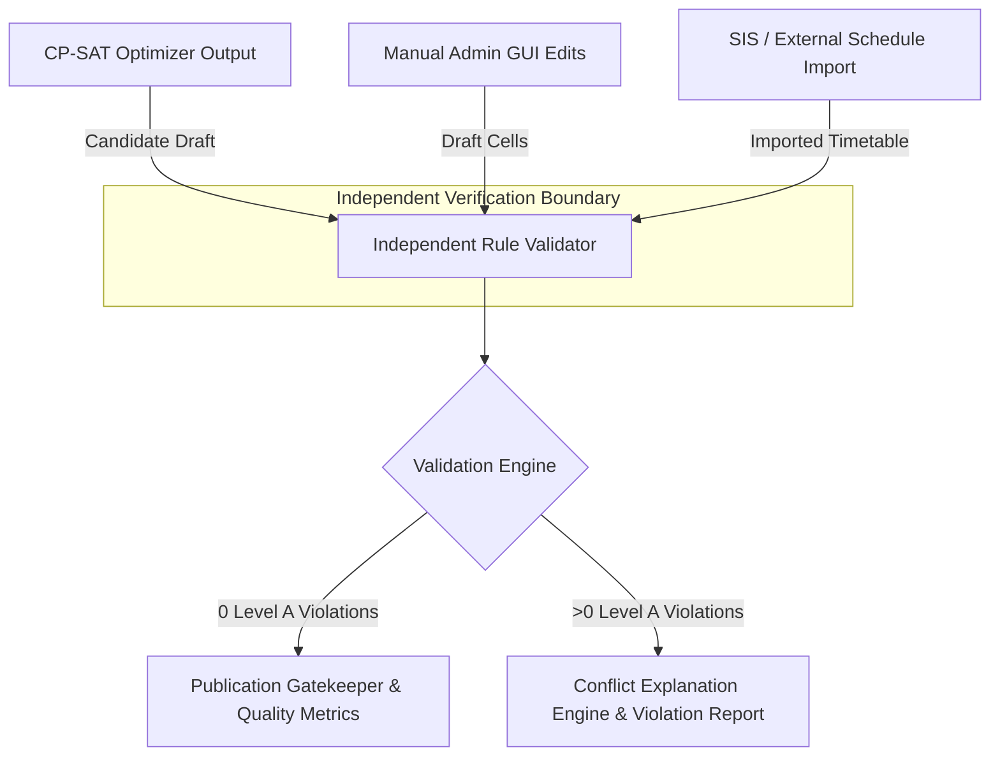
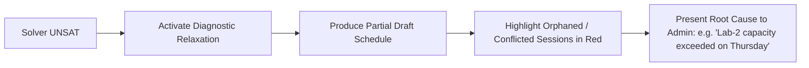

# EduPlus — Validation, Inference & Conflict Explanation

> **Document ID:** VALIDATION_AND_INFERENCE  
> **Version:** 0.1  
> **Status:** Specification Baseline — Planned for Phase 2 Implementation  

---

## 1. Architectural Independence Principle

A foundational architectural requirement of EduPlus is that the **Timetable Validator must be completely decoupled from the Optimization Solver**.



### Why Validator Independence is Mandatory
1. **Solver Blind Spots:** Constraint programming solvers may contain modeling bugs or subtle logic shortcuts in custom propagators. An independent validator audits the resulting schedule against ground-truth domain rules without relying on solver state.
2. **Multi-Source Validation:** Timetables can be edited manually in the GUI, modified by repair operations, or imported from legacy university SIS systems. The validator evaluates any schedule representation identically regardless of origin.
3. **Auditability & Explainability:** The validator's purpose is not just to return a boolean `True`/`False`, but to generate structured conflict graphs, impact analysis, and clear natural-language explanations for academic coordinators.

---

## 2. Validation Stages & Pipeline

The validation pipeline operates in two distinct stages:

```
[Academic Database] 
       │
       ▼
1. Pre-Solve Validation (Static Invariants)
       │ Pass
       ▼
[CP-SAT Solver]
       │
       ▼
2. Post-Solve Independent Schedule Validation (Spatiotemporal Checks)
       │
       ▼
[Publication Gatekeeper / Conflict Report]
```

---

## 3. Stage 1: Pre-Solve Validation (Static Consistency)

Pre-solve validation checks static domain invariants before running the computationally expensive optimizer. If a pre-solve check fails, it indicates an **Impossible Demand** (Data Error), not a combinatorial scheduling conflict.

### Pre-Solve Verification Matrix

| Check ID | Verification Rule | Error Type | Resolution Action |
| :--- | :--- | :--- | :--- |
| **PRE-01** | $\sum_{\text{sessions}} \text{duration} \le \text{Cap}_f$ for each teacher $f$ | Hard Error | Workload overload; reassign courses or increase teacher cap. |
| **PRE-02** | Room Capacity $\ge$ Division / Batch Strength for all assignments | Hard Error | Cohort cannot fit in assigned classroom; assign larger room. |
| **PRE-03** | Total Lab Session Demand $\le$ Total Active Lab Hours available | Hard Error | Department lab facilities oversubscribed. |
| **PRE-04** | Total Division Required Hours $\le$ Working Days $\times$ (Slots/Day - Lunch) | Hard Error | Curriculum exceeds available weekly hours ($6 \times 7 = 42\text{ hrs}$). |
| **PRE-05** | Every subject has at least one qualified assigned teacher | Hard Error | Unassigned syllabus subject; update teaching assignments. |
| **PRE-06** | Elective enrollment groups do not reference non-existent students | Data Error | Orphaned cohort record; verify student enrollments. |

---

## 4. Stage 2: Post-Solve Independent Schedule Validation

Once a timetable candidate is generated or edited, the independent validator checks every scheduled session against the rule catalogue defined in `SCHEDULING_RULES.md`:

### 4.1 Evaluation Sequence

1. **Level A (Hard Constraints):**
   - No teacher double-booking ($A01$)
   - No room double-booking ($A02$)
   - No group overlap conflict ($A03$)
   - Batch partition concurrency ($A04$)
   - Consecutive 2-hour lab continuity ($A05$)
   - Daily working bounds ($A06$)
   - Mandatory division lunch window ($A07$)
   - Teacher declared unavailabilities ($A08$)
   *Rule:* Any Level A failure terminates the pipeline with status `INVALID` and blocks publication.

2. **Level B (Policy Limits):**
   - Student daily load $\le 6$ hours ($B01$)
   - Faculty daily load $\le 5$ hours ($B02$)
   - Faculty consecutive teaching $\le 3$ hours ($B03$)
   - Student internal gap limit $\le 1$ hour ($B05$)
   *Rule:* Level B breaches produce warnings and require explicit administrative policy relaxation to proceed.

3. **Level C (Soft Preferences):**
   - Internal student gaps, room hopping, teacher preferred windows, weekly subject distribution.
   *Rule:* Computed as a 0–100% Quality Score to rank candidate solutions.

---

## 5. Conflict Explanation Engine

When validation detects a defect, the Conflict Explanation Engine translates internal entity identifiers and slot indices into clear, actionable prose.

### Explanation Architecture

```json
{
  "violation_id": "v_a01_102",
  "rule_id": "A01",
  "rule_level": "A",
  "severity": "error",
  "summary": "Teacher Double-Booking",
  "explanation": "Dr. Priya Sharma is scheduled to teach simultaneously in two different locations on Tuesday during Slot 3 (11:00 – 12:00): Machine Learning in LH-101 for Third Year Div A, and Deep Learning in LH-102 for Third Year Div B.",
  "involved_entities": {
    "teacher": { "id": "t001", "name": "Dr. Priya Sharma" },
    "sessions": [
      { "id": "s_101", "subject": "Machine Learning", "room": "LH-101", "group": "Third Year Div A" },
      { "id": "s_204", "subject": "Deep Learning", "room": "LH-102", "group": "Third Year Div B" }
    ],
    "time": { "day": "Tuesday", "slot": "TS3", "time_window": "11:00 – 12:00" }
  },
  "suggested_remediation": "Move one of the sessions to Thursday Slot 2 or assign a co-faculty to Deep Learning."
}
```

### Explanation Templates by Rule

- **A01 (Teacher Clashing):**  
  `"{teacher_name} is double-booked on {day} during {time_slot} for {session_1_subject} ({session_1_room}) and {session_2_subject} ({session_2_room})."`
- **A02 (Room Clashing):**  
  `"Room {room_name} is allocated simultaneously on {day} at {time_slot} to {session_1_group} ({session_1_subject}) and {session_2_group} ({session_2_subject})."`
- **A03 (Group Overlap):**  
  `"Elective conflict: {group_a_name} and {group_b_name} both have classes scheduled on {day} during {time_slot}, but share {count} enrolled students."`
- **A07 (Lunch Infringement):**  
  `"Division {division_name} has a scheduled session during its mandatory lunch period on {day} ({time_slot})."`
- **B03 (Teacher Consecutive Hours):**  
  `"{teacher_name} is assigned {consecutive_hours} consecutive hours on {day} from {start_slot} to {end_slot}, exceeding the policy limit of 3 hours."`

---

## 6. Diagnostic Partial Drafts (Handling Infeasibility)

When pre-solve checks pass but CP-SAT returns `INFEASIBLE`:

1. **Distinction: Infeasible vs Timeout:**
   - **TIMEOUT:** Solver exhausted its time budget (e.g., 90s) without completing the proof. It does **not** prove the timetable is impossible. Action: Increase time limit or relax soft Level C weights.
   - **INFEASIBLE:** Mathematically proven that no combination of slot assignments can satisfy all Level A constraints simultaneously.
2. **Minimal Unsatisfiable Subset (MUS) Isolation:**
   The diagnostic engine activates **Relaxation Mode**:
   - Softens Level B constraints with heavy penalty slack variables.
   - Converts Level A teacher availability constraints into soft penalties.
   - Generates a **Diagnostic Partial Draft** showing 95% of the schedule successfully placed, visually highlighting the unplaceable 2–3 sessions and pinpointing the exact bottleneck.



---

## 7. Publication Gatekeeper Rules

A candidate timetable version can transition to `PUBLISHED` **only if** the independent validator certifies:

$$\text{EligibleForPublication} \iff (\text{Violations}_A = 0) \land (\text{Violations}_B = 0 \lor \text{AllBreachesApproved}) \land (\text{UnscheduledSessions} = 0)$$

1. **Zero Level A Violations:** Absolute zero tolerance. The UI publish button is strictly disabled if any Level A violation exists.
2. **Approved Policy Relaxations:** If any Level B policy is exceeded (e.g., faculty teaching 4 consecutive hours), an authorized Administrator must submit an explicit sign-off reason recorded in `POLICY_RELAXATION`.
3. **100% Curriculum Completeness:** Every session defined in `SESSION_REQUIREMENT` must be present in `SCHEDULED_SESSION`.

---

## 8. Test Verification Scenarios

The validator behavior is verified through automated test suites:

- **TC-VAL-01 (Teacher Collision):** Construct two mock sessions for Teacher `t001` at `Monday TS2`. Assert validator returns Rule `A01` with severity `error`.
- **TC-VAL-02 (Elective Overlap):** Schedule `EG_CV` and `EG_NLP` at `Wednesday TS4`. If `shared_student_count > 0`, assert Rule `A03` is flagged.
- **TC-VAL-03 (Lunch Protection):** Schedule lecture in `TS6` for Division 3A (whose lunch is `TS6`). Assert Rule `A07` is flagged.
- **TC-VAL-04 (Consecutive Hours Warning):** Schedule 4 back-to-back 1-hour lectures for Teacher `t002`. Assert Rule `B03` warning is produced.
